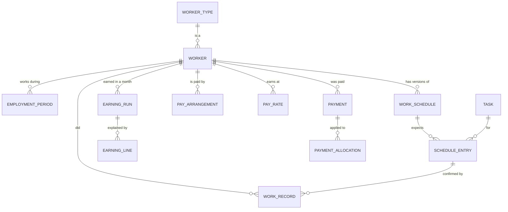

# Home Expense Manager

A simple, offline household staff and pay application for a single household on one
computer. Tell it each day what happened (worked, litres of milk, hours, leave, holiday) and
it works out what each person has earned in the month, exactly to the paisa.

## How to use it

1. **Staff**: add each worker once: job, start date, how they are paid (monthly salary, per
   day, per hour, per litre) and the weekdays they work.
2. **Today**: each day tap **Done** for each worker. For the milkman type the litres and press
   **Save litres**, or press **No delivery**. For an hourly worker type the hours. Use
   **Our holiday**, **On leave** or **Didn't come** when someone did not work. Wrong tap? Press **Undo**.
3. **Monthly Pay**: see what each person earned, what was paid so far and what is still to pay.
   Type the amount and press **Record payment**. **Give an advance** for money ahead of pay.
   After a month ends, press **Close this month**. If someone did not come, answer **Reduce pay for
   this day?** on the Today screen first.
4. **Backup**: download one file with all your records and keep it safe. To go back to a backup,
   choose the file on the same page and start the program again.

## Known limits (version 1)

- One household, one shared password (optional), no separate users or roles. Without a password the
  server only accepts connections from this computer. A form post that came from another website is
  always refused (`SameOriginFilter`).
- Closing a month leaves any unpaid amount as "still to pay" (it is not carried to the next month),
  and turns any overpayment into an advance. Reopening a closed month, corrections to payments and
  settlement adjustments have no screens yet; the services exist and are tested.
- An advance is taken back from the next month closed after it was given, never from an earlier month.
- Changing pay or weekdays only works from a date with no recorded work or finished earnings after it.
- Restoring a backup takes effect the next time the program starts. The records it replaced are kept
  as `home-expense.db.before-restore`.
- Leave rule (as in the original project): approved leave is unpaid for monthly-salary staff
  (one day's pay is taken off); a household holiday is paid. Pinned by `BreakItTest`.
- Opening Monthly Pay recalculates in memory only; nothing is saved until a month is closed.

## Design

**Layers** (each only calls the one below it):

```
browser -> controller (HTTP, form parsing, messages)
        -> service    (all business rules, @Transactional, audit log)
        -> repository (Spring Data JPA)
        -> SQLite     (schema owned by Flyway migrations)
```

`controller/` has one class per screen plus `WebErrorAdvice`, which turns a
`BusinessRuleException` into a plain message on the same page. All money maths is in
`service/EarningsCalculator` using exact fractions (`money/Fraction`), rounded half-up once to
the paisa.

**Use cases**

| Who | Does | Screen |
| --- | --- | --- |
| Homemaker | Add a worker with pay and weekdays | Staff |
| Homemaker | Change pay or weekdays from a date, or record a last working day | Staff |
| Homemaker | Record the day: done, litres, hours, leave, holiday, no delivery | Today |
| Homemaker | Take back a wrong entry | Today (Undo) |
| Homemaker | See what each person earned, paid so far and still to pay | Monthly Pay |
| Homemaker | Record a payment | Monthly Pay |
| Homemaker | Keep a copy of all records | Backup |

**Main tables** (full schema in `src/main/resources/db/migration`):



Records are never edited or deleted: a correction voids the old row and adds a linked one, so
the history always shows what was entered and when.

## Status

- Phase 1 (project foundation): Spring Boot application, SQLite connection, Flyway
  migrations, a placeholder home page and automated tests.
- Phase 2 (workers, schedules and rates): database tables, services, validation and
  tests for workers and employment periods, tasks and shifts, effective-dated weekly
  schedules, payment arrangements and pay-rate history, plus an audit log. There are no
  screens for these yet.
- Phase 3 (daily work and attendance): recording what actually happened for each
  scheduled activity (done, partly done, or not done because of a household holiday,
  approved leave or unauthorized absence), unscheduled extra work, duplicate warnings,
  deduction decisions for unauthorized absences, and void-and-replace corrections with
  full history. Backend only; no screens yet, and no earnings are calculated.

- Phase 4 (earnings calculation): monthly earnings per worker for all six payment models,
  calculated from recorded work, effective-dated rates and schedules. Every amount is an
  exact fraction rounded half-up once to the paisa and explained line by line. Partial
  work and amounts without a baseline wait for review; unrecorded scheduled activities
  block finalizing until recorded or explicitly confirmed. Finalized months lock their
  work records, rates and schedules. Backend only; no screens yet.

- Phase 5 (payments and settlements): payments with automatic oldest-first, explicit or
  "keep unallocated" allocation; excess handling; advances and automatic recovery;
  versioned monthly settlements with rounding, carry-forward and overpayment decisions;
  audited reopening of earnings and settlements; corrections by adjustment, reversal or
  reviewed void-and-replace. Financial history is never edited or deleted. Backend only.

- Phase 6 (screens): a Thymeleaf website in an earthy, minimal theme (see
  `src/main/resources/static/css/app.css`) built on the services above. Today, Staff,
  Monthly Pay and Backup. Settlements, advances and corrections have no screens yet.

## Requirements

- JDK 21
- An internet connection the first time you build (to download Maven and dependencies).
  The application itself runs fully offline.

You do not need Maven installed: the included Maven Wrapper (`./mvnw`) downloads the
correct version (3.9.16) automatically.

## Technology

Java 21, Spring Boot 4.1, Spring Data JPA / Hibernate 7.4 with the SQLite community
dialect, SQLite (xerial sqlite-jdbc), Flyway, Thymeleaf, JUnit.

## Build and test

```bash
./mvnw clean verify
```

Integration tests use a real SQLite database in a temporary folder. They never touch
the live household database.

## Run

**Easiest:** double-click `run.bat` (Windows) or run `./run.sh` (Mac/Linux). The first start builds the
program (about a minute), then your browser opens at <http://127.0.0.1:8080/>. Close the window to stop it.

**For development:** `./mvnw spring-boot:run`, or build once with `./mvnw -DskipTests package` and run
`java -jar target/home-expense-manager.jar`.

By default the server only accepts connections from this computer. To let other people use it, set
`SERVER_ADDRESS=0.0.0.0` and put HTTPS in front (see **Accounts** below).

## Run with Docker

1. `docker compose up -d`
2. Open <http://localhost:8080/> and choose **Create your free account**.

Records are kept in the Docker volume `home-expense-data`, so they survive restarts and upgrades. To upgrade:
`git pull`, then `docker compose up -d --build`. Check health with `docker compose ps` or
<http://localhost:8080/actuator/health>. The container runs as a normal (non-root) user. Keep the data volume
on a local disk, not a network drive (SQLite needs a real local file system).

The compose file publishes the port to this computer only. To open it to your home network change the port
line to `"8080:8080"`, and put HTTPS in front (for example a reverse proxy), because a password typed over
plain HTTP can be read on the network.

## Accounts: many people, each with a private household

Anyone can **sign up** with a name, email and password. Each person gets a household of their own, with its own
database file (`<data folder>/households/<id>.db`), so one household can never see another's records. Sign-in
details live separately in `<data folder>/accounts.db`.

- **Recovery:** sign-up shows a one-time recovery code. **Forgot password** needs the email and that code and then
  gives a new code. There is no email service, so a person who loses both must be reset by whoever runs the server.
- **Safety:** forms carry a one-time token, five wrong sign-ins lock that email and that address for ten minutes,
  sign-ups are limited to five per address per hour and `HOME_EXPENSE_MAX_HOUSEHOLDS` in total (default 500).
- **Delete my account** on the Account page removes the household's file and backups.
- **Records made with the older one-household version** are kept: the first person to sign up takes them over.
- Behind HTTPS, set `HOME_EXPENSE_SECURE_COOKIE=true`.
- Email is not verified and is not used to send anything.

## Settings

Set these as environment variables (or as `--name=value` options):

| Variable | Meaning | Default |
| --- | --- | --- |
| `HOME_EXPENSE_DATA_DIR` | Folder holding all records (one file per household) | `~/.home-expense-manager` |
| `HOME_EXPENSE_TIMEZONE` | Time zone for "today" and month ends, for example `Asia/Kolkata` | this computer's zone |
| `HOME_EXPENSE_SECURE_COOKIE` | `true` once the site is served over HTTPS | `false` |
| `HOME_EXPENSE_MAX_HOUSEHOLDS` | How many households may sign up | `500` |
| `SERVER_ADDRESS` | Address to listen on. `0.0.0.0` lets other devices connect (use HTTPS) | `127.0.0.1` |
| `SERVER_PORT` | Port | `8080` |

## Backups

- **By hand:** the **Backup** screen downloads one file with your household's records. Keep copies away from this computer.
- **Automatic:** every day at 02:00 the program saves a copy of each household in `<data folder>/backups/<id>` and keeps the
  newest 14. These are on the same computer, so they protect against mistakes, not against losing the
  computer.
- **Restore:** choose a downloaded backup on the Backup screen. The file is checked first (a damaged file or one
  from a newer version is refused), then it replaces only your household's records at once. The records you had
  before are kept beside it as `<id>.db.before-restore`.

## Testing

`./mvnw clean verify` runs every test. `BreakItTest` tries to break the website (bad numbers, extreme dates,
double clicks, hostile text, damaged backups, forged posts); a `.github/workflows/build.yml` workflow runs the
same on every push. The limits it enforces are in `controller/InputRules.java`: litres up to 1,000 a day,
hours up to 24, amounts up to ₹10,00,000, dates from 2000 to one year ahead.

## Where data is stored

The live database is stored outside this repository:

```
~/.home-expense-manager/home-expense.db
```

The folder is created automatically on first start. SQLite runs in WAL mode, so the
folder may also contain `home-expense.db-wal` and `home-expense.db-shm` files; these are
part of the live database. Do not copy only the `.db` file as a backup. A proper backup
feature is the **Backup** screen: it downloads one complete, consistent copy of the database
(`VACUUM INTO`), so a single file is enough.

To use a different folder (for example, for a trial run):

```bash
./mvnw spring-boot:run -Dspring-boot.run.arguments=--home-expense.data-dir=/path/to/folder
```

## Database conventions

- Schema changes are made only through Flyway migrations in
  `src/main/resources/db/migration`. Hibernate validates the schema but never changes it.
- SQLite foreign keys are enforced on every connection.
- Money is stored as whole paise in `INTEGER` columns (Java `long`; ₹1 = 100 paise),
  never as SQLite `REAL`. Calculations use `BigDecimal`. Entered amounts with more than
  two decimal places are rejected, never rounded.
- Dates are stored as ISO text `YYYY-MM-DD`, times as `HH:MM`, timestamps as UTC text,
  days of the week as 1 (Monday) to 7 (Sunday), and booleans as 0/1. JPA converters in
  `model/converter` apply these conventions.
- Effective-dated records (schedules, payment arrangements, pay rates, employment
  periods) never overlap; this is enforced by triggers as well as by the services. A
  change adds a new version instead of editing an old one.
- Expected activities are not stored; they are worked out from the schedules. Work
  records are confirmed facts and are never edited or deleted: a correction voids the
  record and inserts a linked replacement. Database triggers enforce this.
- `HomeExpenseSQLiteDialect` adjusts Hibernate's SQLite dialect so that schema
  validation accepts SQLite `INTEGER` keys for Java `long`, and so that constraint
  failures are reported as data-integrity errors.

Stop the application before running `./mvnw clean verify`: the build deletes the
compiled classes a running application is using, which makes its pages fail.

## Release checklist

What is done, what is missing and what the review committees found: [docs/RELEASE_CHECKLIST.md](docs/RELEASE_CHECKLIST.md).
